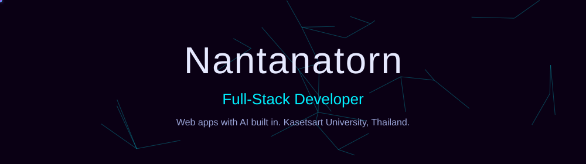
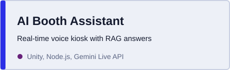
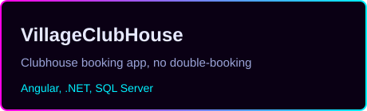
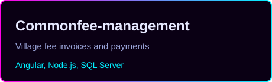
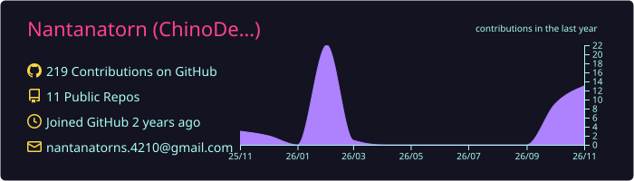
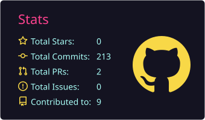
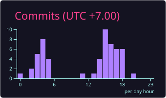
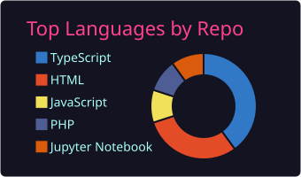
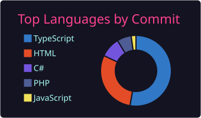

 

## About me

I build complete web applications and add AI features to them, from LLM and RAG integration to real-time voice. I graduated in Information Technology from Kasetsart University in 2026 and I'm looking for an entry-level web, software or AI developer role, remote or hybrid.

- Based in Chonburi, Thailand
- Currently exploring: Gemini Live API, RAG, Stable Diffusion watermarking
- Contact: [nantanatorns.4210@gmail.com](mailto:nantanatorns.4210@gmail.com)

## Tech arsenal

**Frontend**

**Backend and database**

**AI, tools and platforms**

 

## Experience and education

<table>
<tr>
<td width="50%" valign="top">

**Experience**

**Intern, TEEP Internship**
Tamkang University, Taiwan. Feb 2026 to Jun 2026.
Invisible watermarking for Stable Diffusion images. Replaced random embedding-position selection with Particle Swarm Optimization. Across 100 images and 12 attacks, average detection rose from 66.1% to 82.2% with image quality maintained.

**Full Stack Developer Intern**
Exzy Company Limited. Nov 2025 to Feb 2026.
Built AI Booth Assistant, a real-time voice kiosk, with a Node.js backend (Gemini Live API, WebSockets) and a Unity frontend. Added RAG over uploaded PDFs with MongoDB Atlas and session resumption past the 10-minute Live API limit.

</td>
<td width="50%" valign="top">

**Education**

**Kasetsart University, Sriracha Campus**
B.Sc. Information Technology. Jun 2022 to Apr 2026. GPA 3.64.
Scholarship 5A (1/2023, 1/2025), Good Study Award, oral presentation rated "Very Good" at AUCC 2025.

**Languages**
Thai (native), English (B1, TOEIC 595), Chinese (beginner)

**Achievements**

</td>
</tr>
</table>

## Featured projects

 

 

[More on GitHub](https://github.com/Nantanatorn?tab=repositories)

## GitHub dashboard

## Snake eats my contributions

<picture>
  <source media="(prefers-color-scheme: dark)" srcset="https://raw.githubusercontent.com/Nantanatorn/Nantanatorn/output/github-snake-dark.svg" />
  <source media="(prefers-color-scheme: light)" srcset="https://raw.githubusercontent.com/Nantanatorn/Nantanatorn/output/github-snake-dark.svg" />
  
</picture>

## Connect

  

